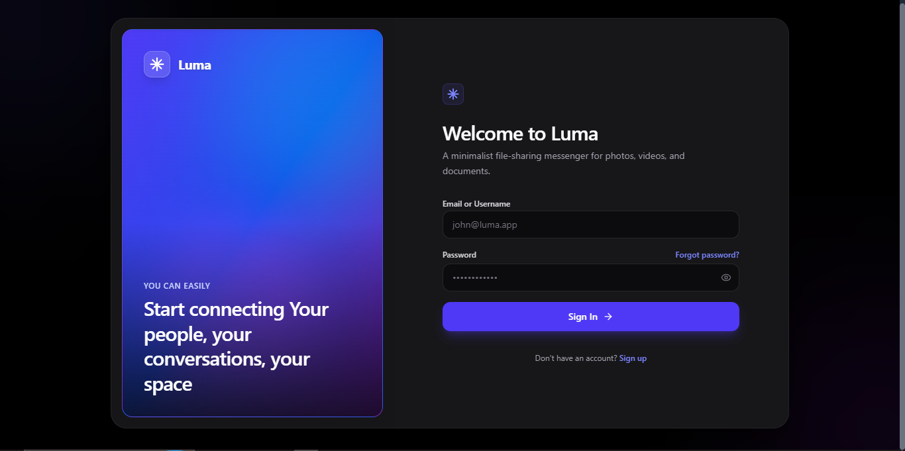
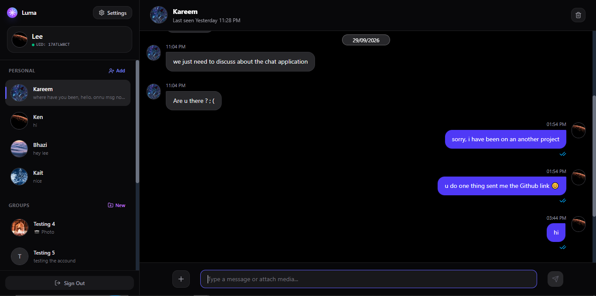
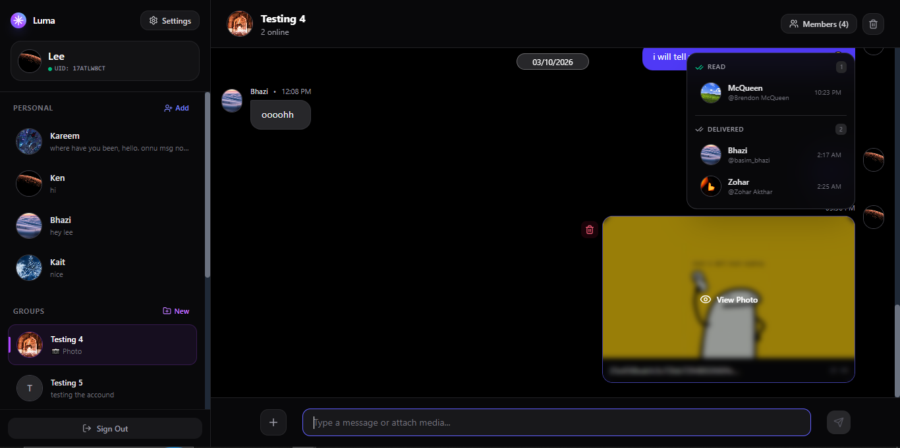
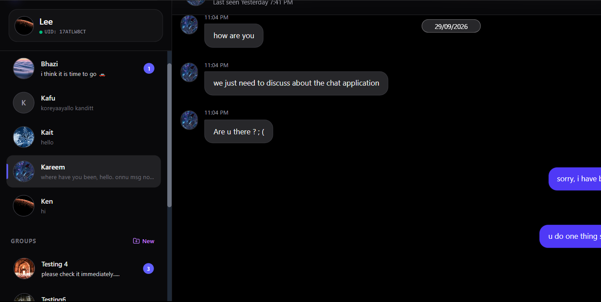
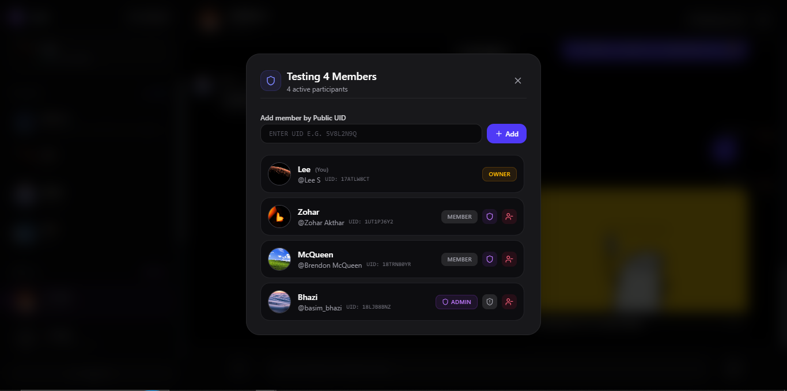
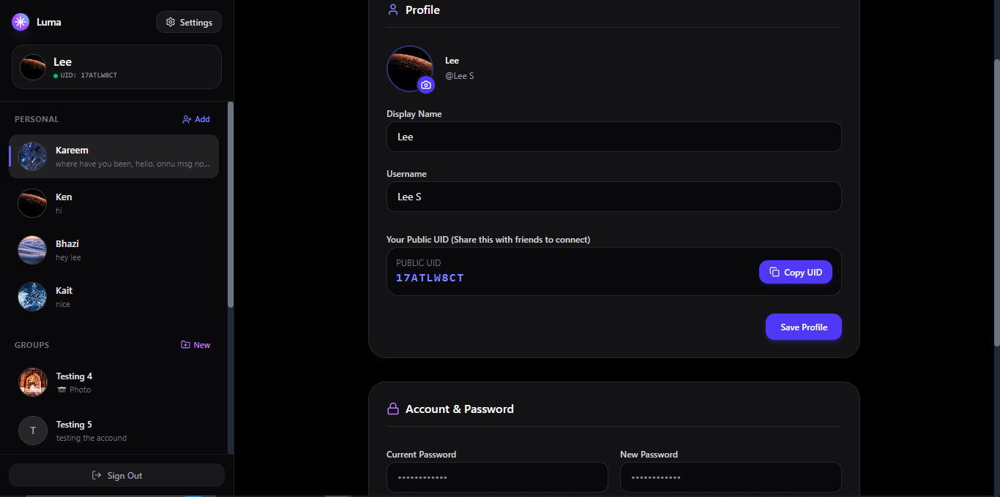

# Real-Time Messaging Platform

A full-stack real-time messaging platform built with **React, Node.js, Express, Socket.IO, PostgreSQL, Redis, and Docker**.

The application provides real-time direct and group messaging with authentication, session management, message delivery and read receipts, unread message tracking, message pagination, online presence, conversation viewer tracking, media/file sharing, UID-based user discovery, and role-based group administration.

The backend uses **Node.js Cluster** with **Redis Pub/Sub** to distribute real-time events across multiple worker processes.

---

## Features

### Authentication & Account Management

- User registration / sign-up
- User login
- JWT-based authentication
- HTTP cookie-based authentication
- Short-lived access tokens
- Long-lived refresh tokens
- Automatic access-token renewal
- Refresh-session validation
- Session creation and management
- Session retrieval
- Session updates
- Session revocation
- Session deletion
- Forgot password functionality
- Password reset
- Profile updates
- Display name updates
- Account deletion

### Authentication Session Flow

The application uses separate access and refresh tokens.

```
Access Token
   │
   │ Valid for 30 minutes
   ▼
API / Socket Authentication
   │
   ▼
Token expires
   │
   ▼
Refresh Token Validation
   │
   ├── Valid
   │     │
   │     ▼
   │   New Access Token
   │
   └── Invalid / Expired
         │
         ▼
      Login Again
```

Current token lifetimes:

| Token         | Lifetime   |
| ------------- | ---------- |
| Access Token  | 30 minutes |
| Refresh Token | 7 days     |

Tokens are stored in HTTP cookies.

Refresh-token session information is maintained server-side in Redis, allowing sessions to be validated and revoked independently of the access-token lifetime.

---

# User Identification

Each registered user receives a unique **9-character alphanumeric UID**.

Example:

```
A7K29XQ4P
```

The UID can be used to find and add users to conversations and groups.

This provides a simple user-discovery mechanism without requiring users to share their email address or phone number.

---

# Direct Messaging

The application supports real-time one-to-one conversations.

Features include:

- Create direct conversations
- Add another user to an existing direct conversation
- Real-time message delivery
- Persistent message history
- Message deletion
- Conversation deletion
- Message pagination
- Unread message tracking
- Delivery receipts
- Read receipts

---

# Group Messaging

The application supports group conversations with role-based administration.

Features include:

- Create groups
- Add users using their unique UID
- Group ownership
- Group administrators
- Promote members to administrators
- Administrators can promote other users according to authorization rules
- Group member management
- Delete groups
- Delete messages

Group roles follow a structure similar to:

```
                     Group Owner
                          │
             ┌────────────┼────────────┐
             │            │            │
             ▼            ▼            ▼
           Admin        Admin        Member
             │            │
          ┌──┴──┐       ┌─┴──┐
          ▼     ▼       ▼    ▼
       Member Member  Member Member
```

---

# Message Status & Receipts

The application implements message status tracking similar to common messaging platforms.

```
✓       Sent

✓✓      Delivered

✓✓      Read
        (Blue)
```

Message state follows:

```
Sent
  │
  ▼
Delivered
  │
  ▼
Read
```

The backend maintains receipt information at the user/message level.

For example:

```
Message
│
├── User A
│   └── Sender
│
├── User B
│   ├── Delivered: Yes
│   └── Read: Yes
│
└── User C
    ├── Delivered: Yes
    └── Read: No
```

This allows the application to determine:

- Who received a message
- Who has read a message
- Who has not received a message
- Who received but has not read a message

The sender's interface can update message status in real time without requiring a page refresh.

---

# Message Pagination

Conversation history is loaded incrementally instead of loading the entire conversation at once.

When a user scrolls toward older messages, the frontend requests the next page of message history.

```
             Older Messages
                    ▲
                    │
              User scrolls up
                    │
                    ▼
             Request older page
                    │
                    ▼
              Load messages
                    │
                    ▼
             Existing history
```

This allows large conversations to be browsed without loading the entire message history into the client at once.

---

# Unread Messages

The application maintains unread message counts for conversations.

Unread state is updated when:

- A new message arrives
- A conversation is opened
- Messages are marked as read

The conversation list can therefore display the current unread count in real time.

Example:

```
Conversations

John                 3
Development Team     7
Family               1
```

---

# Online Presence

The application implements Redis-backed online presence tracking.

Presence is tracked at the **connection level**, rather than simply storing a boolean such as:

```
user.isOnline = true
```

This allows a user to have multiple active connections simultaneously.

For example:

```
User
 ├── Browser ──► Worker 1
 ├── Mobile  ──► Worker 2
 └── Browser ──► Worker 1

             │
             ▼
        User is ONLINE
```

If one connection disconnects while another remains active, the user remains online.

The presence system includes:

- Online/offline tracking
- Multiple connections per user
- Connection-level tracking
- Heartbeat-based connection liveness
- TTL-based connection expiration
- Automatic cleanup of stale connections
- Redis-backed online-user tracking

---

# Conversation Presence

The application also tracks users who are currently viewing a conversation.

Redis maintains information about:

- Conversation members
- Conversation viewers
- Online users

This allows the backend to distinguish between:

```
Online + Viewing
Online + Not Viewing
Offline
```

This information is used when determining which users should receive particular real-time events.

For example:

```
                  New Message
                       │
                       ▼
             Conversation Presence
                       │
          ┌────────────┼────────────┐
          │            │            │
          ▼            ▼            ▼
       Viewing     Online but     Offline
                   not viewing
          │            │            │
          ▼            ▼            ▼
      Real-time    Appropriate    Stored for
       update        event        later handling
```

This presence-aware approach allows the backend to make more targeted decisions when distributing real-time message events.

---

# Media & File Sharing

The application supports sending different types of media and files inside conversations.

Supported content includes:

- Images
- Videos
- Files

Media messages participate in the same conversation and message lifecycle as normal messages.

---

# Real-Time Architecture

The application uses **Socket.IO** for real-time client communication.

The backend uses **Node.js Cluster** to run multiple worker processes.

**Redis Pub/Sub** allows real-time events to be distributed between workers.

**PostgreSQL** is used for persistent application data.

```
                         React Clients
                              │
                    HTTP / Socket.IO
                              │
                              ▼
                  ┌───────────────────────┐
                  │   Node.js Primary     │
                  │       Process         │
                  └───────────┬───────────┘
                              │
                       Creates Workers
                              │
             ┌────────────────┼────────────────┐
             │                │                │
             ▼                ▼                ▼
        ┌──────────┐     ┌──────────┐     ┌──────────┐
        │ Worker 1 │     │ Worker 2 │     │ Worker N │
        │ Socket.IO│     │ Socket.IO│     │ Socket.IO│
        └─────┬────┘     └─────┬────┘     └─────┬────┘
              │                │                │
              └────────────────┼────────────────┘
                               │
                               ▼
                       ┌──────────────┐
                       │    Redis     │
                       │              │
                       │ Pub/Sub      │
                       │ Presence     │
                       │ Sessions     │
                       └──────┬───────┘
                              │
                              ▼
                       ┌──────────────┐
                       │  PostgreSQL  │
                       │              │
                       │ Users        │
                       │ Messages     │
                       │ Groups       │
                       │ Conversations│
                       │ Receipts     │
                       └──────────────┘
```

---

# Message Delivery Architecture

When a user sends a message, the backend persists the message and determines which real-time events need to be distributed.

A simplified flow:

```
User A
  │
  │ Send message
  ▼
React Client
  │
  │ Socket.IO
  ▼
Node.js Worker
  │
  ├──────────────► PostgreSQL
  │                 Store message
  │
  ▼
Redis Pub/Sub
  │
  ├──────────────► Worker with recipient
  │
  └──────────────► Other relevant workers
                         │
                         ▼
                    Recipient
```

Conversation presence is used to determine whether recipients are currently viewing the conversation or are online but viewing something else.

---

# Delivery & Read Flow

The receipt lifecycle is handled independently from the original message event.

```
                  Message Sent
                       │
                       ▼
                  Message Stored
                       │
                       ▼
                 Message Delivered
                       │
                       ▼
                    Message Read
                       │
                       ▼
             Receipt sent to sender
                       │
                       ▼
             Sender UI updates
```

For group conversations, receipt state can be tracked per recipient.

---

# Redis Architecture

Redis has several responsibilities in the application.

### Pub/Sub

Used to distribute real-time events between Node.js workers.

### Presence

Used to maintain:

- Online users
- User connections
- Connection liveness
- Conversation members
- Conversation viewers

### Authentication Sessions

Used for server-side refresh-token session management.

The server can:

- Create sessions
- Retrieve sessions
- Validate sessions
- Update sessions
- Revoke sessions
- Delete sessions

This gives Redis a role beyond simple caching.

```
                         Redis
                           │
          ┌────────────────┼────────────────┐
          │                │                │
          ▼                ▼                ▼
       Pub/Sub          Presence         Sessions
          │                │                │
          │                │                │
    Real-time events    Online users    Refresh sessions
                       Connections
                       Viewers
                       Members
```

---

# Node.js Cluster

The backend uses Node.js's built-in `cluster` module.

The primary process determines the available CPU parallelism and creates worker processes.

```
                    Primary Process
                          │
             ┌────────────┼────────────┐
             │            │            │
             ▼            ▼            ▼
          Worker 1     Worker 2     Worker N
             │            │            │
             └────────────┼────────────┘
                          │
                       Redis
                       Pub/Sub
```

Each worker:

- Connects to PostgreSQL
- Connects to Redis
- Creates the HTTP server
- Initializes Socket.IO
- Handles client connections

Workers are automatically restarted if they exit unexpectedly.

The application also handles graceful shutdown for:

- `SIGTERM`
- `SIGINT`

This architecture allows the application to utilize multiple CPU cores while Redis provides the coordination layer for distributed real-time events.

---

# Authentication Architecture

Authentication consists of three main components:

```
React Client
     │
     ▼
HTTP Cookies
     │
     ├── Access Token
     │
     └── Refresh Token
             │
             ▼
       Redis Session
```

### Access Token

The access token is short-lived and is used for normal authenticated requests.

Current lifetime:

```
30 minutes
```

### Refresh Token

The refresh token has a longer lifetime and is used to obtain a new access token after the access token expires.

Current lifetime:

```
7 days
```

### Refresh Session

Refresh-token session information is maintained server-side in Redis.

When a client needs a new access token:

```
Client
  │
  │ Access token expired
  ▼
Refresh Request
  │
  ▼
Validate refresh session
  │
  ├── Valid
  │     │
  │     ▼
  │ New access token
  │
  └── Invalid / Expired
        │
        ▼
      Login
```

This also provides the ability to revoke individual sessions rather than relying only on token expiration.

---

# Authorization

Authorization is applied to operations such as group management and account-related actions.

Group roles determine which users can perform administrative operations.

The system distinguishes between:

```
Owner
  │
  └── Admin
        │
        └── Member
```

The backend validates authorization before performing protected operations.

---

# Data Storage

PostgreSQL is the primary persistent data store.

The database is responsible for storing application data such as:

- Users
- Authentication-related persistent data
- Conversations
- Groups
- Group membership
- Messages
- Message relationships
- Message receipt information
- Other application data

Redis is used for short-lived and real-time state rather than replacing PostgreSQL as the primary persistent database.

---

# Technology Stack

| Layer                                 | Technology         |
| ------------------------------------- | ------------------ |
| Frontend                              | React              |
| Backend                               | Node.js            |
| HTTP API                              | Express            |
| Real-time communication               | Socket.IO          |
| Authentication                        | JWT + HTTP Cookies |
| Persistent database                   | PostgreSQL         |
| Cache / Pub/Sub / Presence / Sessions | Redis              |
| Multi-process execution               | Node.js Cluster    |
| Infrastructure                        | Docker             |
| Local orchestration                   | Docker Compose     |

---

# Project Structure

The exact structure may vary depending on the current implementation.

```
.
├── backend/
│   ├── src/
│   │   ├── config/
│   │   ├── controllers/
│   │   ├── models/
│   │   ├── routes/
│   │   ├── services/
│   │   ├── socket/
│   │   └── ...
│   ├── package.json
│   └── ...
│
├── frontend/
│   ├── src/
│   ├── package.json
│   └── ...
│
├── docs/
│   └── screenshots/
│
├── docker-compose.yml
├── .env.example
├── .gitignore
└── README.md
```

---

# Running the Project

## Prerequisites

Install:

- Node.js
- npm
- Docker
- Docker Compose
- Git

---

## Clone the Repository

```
git clone https://github.com/YOUR_USERNAME/YOUR_REPOSITORY.git

cd YOUR_REPOSITORY
```

---

## Environment Configuration

Create a local `.env` file from the example:

```
cp .env.example .env
```

Configure the required environment variables.

Example:

```
DB_HOST=localhost
DB_PORT=5433
DB_USER=postgres
DB_PASSWORD=postgres
DB_NAME=postgres

REDIS_URL=redis://localhost:6379

NODE_ENV=development

JWT_SECRET=replace-with-a-secure-random-secret
```

**Never commit the real\*\***`.env`\***\*file to GitHub.**

---

# Start Infrastructure

Start PostgreSQL and Redis:

```
docker compose up -d
```

Check running services:

```
docker compose ps
```

Stop the services:

```
docker compose down
```

---

# Start Backend

```
cd backend
npm install
npm run dev
```

Use the actual script name from your `package.json` if it differs.

---

# Start Frontend

In another terminal:

```
cd frontend
npm install
npm run dev
```

Use the actual script name from your `package.json` if it differs.

---

# Docker

Docker Compose is currently used for infrastructure services such as PostgreSQL and Redis.

```
┌─────────────────────────────────────────┐
│                  Docker                 │
│                                         │
│   ┌────────────────┐ ┌───────────────┐  │
│   │   PostgreSQL   │ │     Redis     │  │
│   │     :5433      │ │     :6379     │  │
│   └────────────────┘ └───────────────┘  │
│                                         │
└─────────────────────────────────────────┘
                 ▲
                 │
            Node.js App
```

Start:

```
docker compose up -d
```

Stop:

```
docker compose down
```

---

# Screenshots

Screenshots are stored under:

```
docs/screenshots/
```

Suggested screenshots:

### Authentication

```

```

### Chat Interface

```

```

### Message Receipts

```

```

### Unread Count

```

```

### Group Management

```

```

### Settings

```

```

---

# Security Considerations

The application uses several security-oriented mechanisms:

- Short-lived access tokens
- Refresh-token sessions
- Server-side refresh-session validation
- Session revocation
- HTTP cookie-based token storage
- Environment variables for secrets
- Separation of persistent data and ephemeral real-time state
- Backend authorization for protected group operations

Sensitive configuration should always be provided through environment variables.

Production deployments should additionally configure appropriate cookie security attributes, HTTPS, CORS policies, rate limiting, input validation, logging, and monitoring.

---

# Design Highlights

Some of the main engineering challenges addressed by the application include:

### Distributed Real-Time Communication

Multiple Node.js workers cannot rely solely on local in-memory state for real-time events.

Redis Pub/Sub provides the communication layer between workers.

### Multi-Connection Presence

A user may have multiple simultaneous connections.

Presence therefore tracks individual connections and only considers the user offline when no active connection remains.

### Conversation-Aware Events

The application tracks both conversation members and active conversation viewers.

This allows message events to be handled differently depending on whether a user is currently viewing the conversation.

### Per-User Message Receipts

Message delivery and read state can be tracked independently for individual recipients.

### Session Lifecycle

Access and refresh tokens have different lifetimes, while refresh sessions are maintained server-side so sessions can be validated and revoked.

### Message Pagination

Large conversations are not loaded entirely into the client at once. Older messages are retrieved as the user scrolls through the conversation history.

---

# Future Improvements

Potential future improvements include:

- Typing indicators
- Online/offline presence UI improvements
- Message reactions
- Push notifications
- Message search
- Message editing
- Automated test coverage
- Integration and end-to-end testing
- CI/CD pipeline
- Production deployment
- Monitoring and observability
- Rate limiting
- Horizontal deployment across multiple server instances

---
